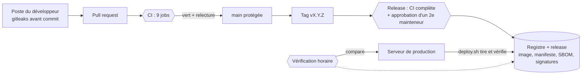

# 10. Intégration et déploiement continus

> Statut : proposé le 2026-10-22. Principes de sécurité : [09-sdlc-devsecops.md](09-sdlc-devsecops.md). Forge : [D11](decisions/D11-forge-et-integration-continue.md). Intégrité du code servi : [D12](decisions/D12-integrite-du-code-servi.md).

## 1. Vue d'ensemble

**Principe : la CI construit et signe, elle n'a aucun accès à la production.** Le serveur tire la release et refuse tout artefact qui n'est pas signé par le workflow de release, au tag exact demandé. Voler un jeton de CI ne suffit donc pas à déployer.

## 2. Contrat avec l'application

Le pipeline s'appuie sur ces éléments de l'application.

| Élément                                                                                       | Utilisé par                        | État                                   |
| --------------------------------------------------------------------------------------------- | ---------------------------------- | -------------------------------------- |
| Scripts `lint`, `check`, `test:unit`, `build`                                                 | Jobs `qualite`, `build`            | ✅                                     |
| `version: { name: process.env.MAIEUTIK_VERSION ?? 'dev' }` dans les options de `sveltekit()` | Build reproductible (D12)          | ✅                                    |
| Champ `packageManager` dans `package.json`                                                    | Même version de pnpm partout       | ✅                                     |
| Route `/healthz` : 200, sans détail interne                                                   | Healthcheck compose, déploiement   | ✅ (`select 1`)                        |
| Route `/.well-known/maieutik/build.json` : `{ "version", "root" }` lus dans `build/client-manifest.json` | Test de fumée, vérification horaire | ✅                           |
| `scripts/migrate.ts` et `db/migrations`, migrations **additives** uniquement                 | Service `migrate`, retour arrière  | ✅ (règle additive à respecter)        |
| PG* + `DATABASE_PASSWORD_FILE` (`src/lib/server/db-options.ts`)                               | Compose : mot de passe en secret   | ✅                                     |
| Routes publiques listées dans `tests/invariants-vie-privee.e2e.ts`                            | Invariants I3 à I8                 | À tenir à jour                         |

**Build reproductible, mesuré le 2026-10-22** sur l'application réelle : deux builds depuis deux chemins et deux fuseaux différents ne diffèrent que par `_app/version.json`, qui contient l'horodatage du build. Avec `version.name` fixé, les 54 fichiers du code client sont identiques octet par octet.

## 3. Pipeline de PR ([ci.yml](../.github/workflows/ci.yml))

| Job                | Contenu                                                                                                                                        | Bloquant           |
| ------------------ | ---------------------------------------------------------------------------------------------------------------------------------------------- | ------------------ |
| `controles`        | Tests des scripts de contrôle, tests des règles Semgrep, Caddyfile sans journal, actionlint, zizmor                                            | Oui                |
| `secrets`          | gitleaks sur tout l'historique                                                                                                                 | Oui                |
| `qualite`          | `pnpm lint` (Prettier, ESLint), `pnpm check` (svelte-check), `pnpm test:unit`                                                                  | Oui                |
| `sast`             | Semgrep : règles maison ; exceptions `nosemgrep` limitées à `.semgrep/exceptions.txt` ; règles communautaires JS et TS publiées dans Code scanning | Maison : oui |
| `dependances`      | `pnpm audit` (haute et critique), osv-scanner                                                                                                  | Oui                |
| `build` (×2)       | Deux builds dans des conditions différentes, manifeste du code client, ressources externes dans la sortie                                     | Oui                |
| `reproductibilite` | Comparaison des deux manifestes                                                                                                                | Oui                |
| `e2e`              | Postgres (image de production), migrations, Playwright (dont les invariants), ressources externes dans le HTML servi, canari IP et User-Agent, ZAP passif | Oui, sauf ZAP au départ |
| `image`            | Build Docker, utilisateur non root, Trivy (image et Dockerfile), pile complète Caddy + application + Postgres, test de fumée, canari à travers Caddy | Oui            |

### Règles d'écriture des workflows

- Actions épinglées par SHA de commit, avec la version en commentaire ; Dependabot les met à jour.
- Peu d'actions tierces : `actions/*`, `pnpm/action-setup`, `sigstore/cosign-installer`, `github/codeql-action`, `ossf/scorecard-action`. Les outils de sécurité tournent dans des **images épinglées par digest**, déclarées dans [.github/tools/Dockerfile](../.github/tools/Dockerfile) et lancées par [scripts/ci/tool.sh](../scripts/ci/tool.sh).
- `permissions: {}` en tête de fichier, permissions minimales par job ; `persist-credentials: false` ; jamais `pull_request_target` ; aucun secret.
- Aucune expression `${{ }}` dans un script : les valeurs passent par `env`.
- Pas de cache dans le workflow de release.

### Contrôles maison

| Script                                                                          | Rôle                                                                                                                  |
| ------------------------------------------------------------------------------- | --------------------------------------------------------------------------------------------------------------------- |
| [check-external-resources.mjs](../scripts/ci/check-external-resources.mjs)      | HTML, SVG, CSS : aucune ressource d'une autre origine, aucun `javascript:`, liens externes en `noreferrer`, pas de lien absolu vers le site lui-même |
| [check-caddy-config.mjs](../scripts/ci/check-caddy-config.mjs)                  | Journaux discardés, aucun `log` dans un site, X-Forwarded-For retiré, pas d'e-mail ACME                              |
| [client-manifest.mjs](../scripts/ci/client-manifest.mjs)                        | Génère, compare et vérifie à distance le manifeste du code client (D12)                                               |
| [verify-production.sh](../scripts/ci/verify-production.sh)                      | Vérifie un site en production contre la release signée qu'il annonce ; utilisable par n'importe qui                   |

Leurs tests : `node --test 'scripts/ci/tests/*.test.mjs'` (17 tests).

## 4. Release ([release.yml](../.github/workflows/release.yml))

Déclenchée par un tag `vX.Y.Z` (SemVer), dont la création est réservée aux mainteneurs.

1. CI complète (le workflow `ci.yml` est rappelé tel quel).
2. Pause : un **second mainteneur** approuve l'environnement `release`.
3. Build de l'image sans cache ; le manifeste du code client est recalculé depuis l'image et comparé à celui qu'elle contient.
4. SBOM (Syft, SPDX), publication de l'image sur GHCR.
5. Signatures Sigstore sans clé : image, attestation SBOM, manifeste, configuration de déploiement. Provenance SLSA.
6. Release GitHub avec les artefacts.

| Artefact                                         | Contenu                                                      |
| ------------------------------------------------ | ------------------------------------------------------------ |
| `image-digest.txt`                               | Digest de l'image ; le déploiement se fait toujours par digest |
| `client-manifest.json` + `.sigstore.json`        | SHA-256 de chaque fichier client, racine, signature          |
| `deploy-bundle.tar.gz` + `.sigstore.json`        | `compose.yaml`, `Caddyfile`, `tor/` de ce tag, archive déterministe |
| `sbom.spdx.json`                                 | Inventaire des composants de l'image                         |

L'identité de signature est `https://github.com/<organisation>/maieutik/.github/workflows/release.yml@refs/tags/vX.Y.Z` : une signature produite par un autre workflow, une autre branche ou un autre tag est refusée.

## 5. Image ([Dockerfile](../Dockerfile))

- Deux étapes : build sur `node:24-trixie-slim`, exécution sur **distroless** `nodejs24` (ni shell ni gestionnaire de paquets), utilisateur 65532.
- Bases épinglées par digest. Le manifeste du code client est produit pendant le build.
- Durcissement à l'exécution ([deploy/compose.yaml](../deploy/compose.yaml)) : système de fichiers en lecture seule, toutes les capacités retirées, `no-new-privileges`, limites de mémoire et de processus.
- Réseaux : l'application est sur des réseaux `internal` (Caddy, Postgres, robot) et **ne peut joindre aucune adresse extérieure** (I13).
- Robot d'archivage (D15) : même image, commande `scripts/archiver.ts`. Il rejoint l'application par le réseau interne `archive` et sort vers Internet par `archive_egress`, réseau qui n'est qu'à lui : il ne voit ni Postgres, ni Caddy, ni Tor. La sortie est en IPv4 seule. Caddy répond 404 à `/internal*` sur les deux voies (I14).

## 6. Déploiement ([deploy/deploy.sh](../deploy/deploy.sh))

Lancé par un opérateur sur le serveur : `sudo deploy.sh v1.4.0`.

1. Télécharge les artefacts de la release.
2. Vérifie avec cosign que le manifeste, la configuration et l'image sont signés par `release.yml` **à ce tag**.
3. Installe la configuration vérifiée dans `/opt/maieutik/releases/<version>`.
4. Sauvegarde la base, chiffrée pour la clé publique age (la clé privée est hors ligne).
5. Applique les migrations.
6. Bascule, puis test de fumée de bout en bout à travers Caddy : version et racine annoncées par `build.json`.
7. En cas d'échec, revient automatiquement à la version précédente. `deploy.sh --rollback` le fait à la demande.

**Migrations additives** (expand/contract) : une release n'enlève jamais une colonne que la version précédente utilise ; la suppression vient dans une release ultérieure. Sinon le retour arrière casserait.

### Première installation

1. Serveur : Docker, cosign (version épinglée, somme de contrôle vérifiée), age, curl. SSH par clé matérielle uniquement, journald en mémoire.
2. `/etc/maieutik/deploy.conf` : `MAIEUTIK_REPO`, `MAIEUTIK_DOMAIN`, `BACKUP_RECIPIENT`.
3. `/etc/maieutik/secrets/` (0400) : `db_password` (mot de passe Postgres, lu par l'application et par Postgres) `session_key` (32 octets aléatoires, clé HMAC des preuves de travail) et `archiver_token` (jeton aléatoire partagé par l'application et le robot). Les clés publiques des référents vont dans `MAIEUTIK_REFERENT_KEYS` de `deploy.conf`.
4. `deploy.sh vX.Y.Z` : l'adresse onion est lue au premier démarrage de Tor et injectée dans l'en-tête `Onion-Location`.
5. **Sauvegarder hors ligne la clé du service onion** (`/var/lib/tor/maieutik/hs_ed25519_secret_key` dans le volume `tor_data`), chiffrée avec age. Sa perte change l'adresse onion ; son vol permet de l'usurper.
6. Renseigner les variables `PRODUCTION_URL` et `PRODUCTION_ONION_URL` du dépôt pour activer la vérification horaire.

## 7. Environnements

| Environnement  | Rôle                                                                  |
| -------------- | --------------------------------------------------------------------- |
| Local          | `pnpm dev`, Postgres via `docker compose up db`                       |
| CI éphémère    | Jobs `e2e` et `image` : tient lieu de préproduction                   |
| Production     | Un seul serveur (D10), accès clearnet et onion                        |

Pas de préproduction permanente : budget de dons (D08) et un seul serveur (D10). La pile complète est montée à chaque PR dans le job `image`.

## 8. Secrets et accès

| Secret                              | Où                                       | Rotation                     |
| ----------------------------------- | ---------------------------------------- | ---------------------------- |
| Jeton de CI                         | `GITHUB_TOKEN` éphémère, droits par job  | Automatique                  |
| Signature des releases              | Aucun : Sigstore sans clé, certificat de 10 min | Sans objet            |
| Mot de passe Postgres               | `/etc/maieutik/secrets` sur le serveur   | Annuelle, ou après incident  |
| Clé du service onion                | Volume `tor_data` + copie chiffrée hors ligne | Après incident seulement (nouvelle adresse) |
| Clé HMAC des preuves de travail     | `/etc/maieutik/secrets/session_key`      | Annuelle (invalide seulement les défis en cours) |
| Jeton du robot d'archivage          | `/etc/maieutik/secrets/archiver_token`   | Annuelle, ou après incident  |
| Clé privée des sauvegardes (age)    | **Hors ligne**, deux exemplaires, deux opérateurs | Après incident        |
| Certificats TLS                     | Caddy (ACME, sans e-mail)                | Automatique                  |
| Accès SSH                           | Une clé FIDO2 par opérateur              | Au départ d'un opérateur     |

## 9. Surveillance continue

| Workflow                                                                  | Fréquence     | Échec signifie                                         |
| ------------------------------------------------------------------------- | ------------- | ------------------------------------------------------ |
| [verify-production.yml](../.github/workflows/verify-production.yml)       | Chaque heure  | Code servi différent de la release signée, ou certificat TLS expirant |
| [security-scheduled.yml](../.github/workflows/security-scheduled.yml)     | Chaque nuit   | Nouvelle vulnérabilité dans le lockfile ou l'image en production |
| [scorecard.yml](../.github/workflows/scorecard.yml)                       | Chaque semaine | Dégradation des pratiques du dépôt                    |

Un échec notifie les mainteneurs. GitHub suspend les workflows planifiés après 60 jours sans activité sur le dépôt : à surveiller en période calme.

## 10. Mise en place

- [ ] Créer le dépôt public et l'organisation pseudonyme (D11, §8 de 09).
- [ ] Règles sur `main` : PR obligatoire, 1 approbation, relecture des code owners, jobs de CI requis, historique linéaire, commits signés, aucun contournement.
- [ ] Règles sur les tags `v*` : création réservée aux mainteneurs, ni modification ni suppression.
- [ ] Environnement `release` : deux relecteurs désignés, auto-approbation interdite, limité aux tags `v*`.
- [ ] Activer : signalement privé de vulnérabilités, alertes et mises à jour de sécurité Dependabot, détection de secrets avec blocage au push, Code scanning.
- [ ] Actions : autoriser seulement les actions listées au §3, exiger l'épinglage par SHA, droits du jeton en lecture seule par défaut.
- [ ] Rendre public le paquet GHCR après la première release (le serveur le tire sans identifiants).
- [ ] Créer les équipes `mainteneurs` et `securite`, reprises dans CODEOWNERS.
- [ ] Postes des développeurs : `TZ=UTC`, signature des commits, gitleaks avant commit (`gitleaks git --pre-commit --staged`).

## 11. État de validation

Validé le 2026-10-22, sans dépôt distant :

- Workflows : actionlint et zizmor sans erreur.
- Scripts de contrôle : 17 tests ; racine du manifeste recalculée à l'identique avec `sha256sum`.
- Règles Semgrep : tous les cas de test passent ; aucune alerte sur le code actuel de l'application.
- Sur l'application réelle : build reproductible (avec `version.name` fixé), pages sans ressource externe, en-têtes de sécurité présents, canari absent des journaux, test Playwright des invariants vert (8 tests).
- `deploy/compose.yaml` validé par `docker compose config`.

Après l'ajout de `version.name` et de la route `build.json` : deux builds depuis deux chemins différents restent identiques, et `build.json` annonce la racine exacte du manifeste.

Non validé : exécution réelle des workflows sur GitHub.

## Questions ouvertes

- Rendre ZAP bloquant une fois les alertes initiales traitées.
- Navigateurs E2E : ajouter Firefox, le plus proche de Tor Browser.
- Déploiement automatique (minuterie qui tire la dernière release signée) ou manuel : manuel au lancement.
- Second serveur pour la base quand le serveur unique sature (08).
- Aléa public pour le tirage du jury (D16, « Limite connue ») : l'application n'ayant aucun accès sortant (I13), un composant isolé, sur le modèle du robot d'archivage, devra récupérer une balise publique (drand ou équivalent) et en vérifier la signature. Source, vérification et réseau à définir avant que le jury ait un rôle réel.
